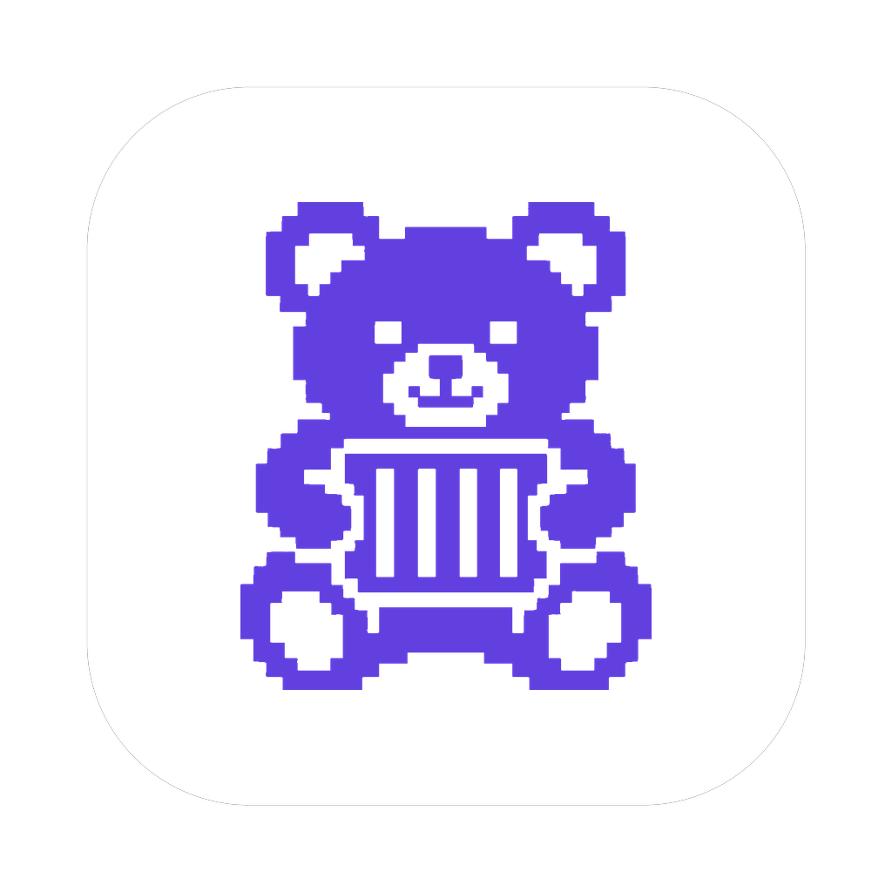

<p align="center"></p>

# telima

A desktop app for [Colima](https://github.com/abiosoft/colima) on macOS and Linux, written in Rust with [GPUI](https://github.com/zed-industries/zed/tree/main/crates/gpui).

> Status: early development. Nothing is usable yet.

## Goal

Do the daily Colima and container work without the terminal:

- create, start, stop, edit and delete Colima profiles, with live progress
- list containers, follow logs, restart and remove them
- see and clean up images and volumes

A menu bar item is planned for a later version.

## Build

Requirements:

- Rust 1.98.1 (pinned in `rust-toolchain.toml`; rustup installs it)
- macOS: Command Line Tools (`xcode-select --install`). Full Xcode is not needed.
- Linux (Debian/Ubuntu): `sudo apt install clang libxkbcommon-x11-dev libwayland-dev libx11-xcb-dev libfontconfig-dev libvulkan1 libssl-dev libdbus-1-dev pkg-config`
- Colima installed and on `PATH` (for running the app, not for building)

```sh
cargo run -p telima
cargo test --workspace
```

## Package

The app id is `APP_ID` in `crates/telima-ui/src/lib.rs`; the scripts below read it from there.

- macOS: `scripts/bundle-macos.sh` builds an unsigned `target/release/bundle/telima.app` with the icon. `cargo run` shows the generic Dock icon.
- Linux: install `packaging/linux/<app id>.desktop` to `~/.local/share/applications/` and copy `assets/icon/hicolor/` into `~/.local/share/icons/hicolor/`. The window reports the same app id, so the desktop shows the icon.
- Icons: `assets/icon/telima.png` (1024 px) is the only master. `scripts/icons.sh` (macOS) regenerates the sizes and `telima.icns` from it. See `docs/icon.md` for where it came from.

## Tray

telima keeps running in the macOS menu bar / Linux system tray after the window is closed; quit from the tray menu. If the icon is missing on macOS, the menu bar is probably crowded (look behind "«", Cmd-drag to reorder, check the System Settings menu bar allow list). GNOME needs the AppIndicator extension. Running telima twice shows two icons. Details (Korean): [docs/tray.md](docs/tray.md).

## Layout

Dependencies point inward only; `scripts/check_layers.py` enforces it in CI.

| Crate | Role |
|---|---|
| `telima-core` | domain entities, rules, port traits |
| `telima-app` | use cases, state, view models |
| `telima-colima` | Colima CLI adapter |
| `telima-docker` | Docker Engine API adapter (bollard) |
| `telima-ui` | GPUI views |
| `telima` | binary; wires everything together |

## License

Licensed under either of [Apache License 2.0](LICENSE-APACHE) or [MIT](LICENSE-MIT) at your option.
